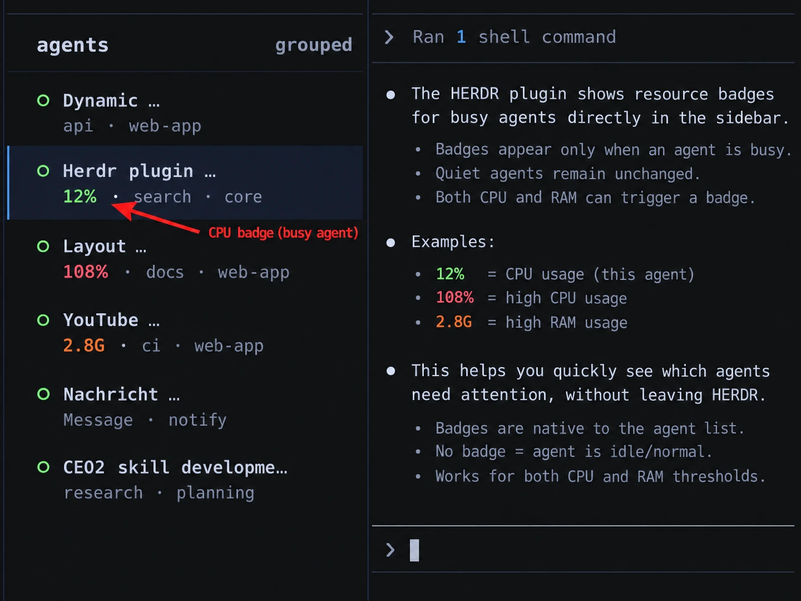

# Agent Resource Badges for herdr

Green, orange and red CPU/RAM badges for every agent in the [herdr](https://herdr.dev)
sidebar. A badge only appears while an agent is actually busy, so a quiet
sidebar looks exactly like it did before.



*Illustration. The badge names the value that sets its colour: green from
10 % CPU or 1.5 GiB, orange from 50 % or 2.5 GiB, red from 100 % or 4 GiB.*

The same as plain text:

```text
agents
◐ Refactor auth middle…
  15% · api · web-app          green: above 10 % CPU
○ Write release notes
  docs · web-app               quiet agent: nothing added
◐ Fix flaky e2e test s…
  108% · ci · web-app          red: more than one full core
○ Index the monorepo f…
  2.8G · search · core         orange: the process tree holds 2.8 GiB
```

## Why

With a dozen agents open, the question is usually not *how busy is the machine*
but *which agent is it*. A single coding-agent session is rarely one process:
a Claude Code pane on the author's machine typically runs around 11 of them
(the agent plus its MCP servers) and holds 0.6 to 1.3 GiB. This plugin sums the
whole process tree below each pane's shell and puts the answer next to the
agent that owns it.

## What the badge means

| Colour | CPU (100 % = one core) | or RAM of the pane's process tree |
|---|---|---|
| no badge | below 10 % | below 1.5 GiB |
| green | from 10 % | from 1.5 GiB |
| orange | from 50 % | from 2.5 GiB |
| red | from 100 % | from 4 GiB |

The worse of the two metrics sets the colour, and the badge names that metric:
`108%` or `2.8G`. CPU is measured like `top`, per core, so an agent that keeps
one core busy reads 100 % on a 4-core laptop and on a 32-core workstation alike.

The **live table** shows both metrics for every pane, the process count and the
busiest process. Open it from the command palette (*Agent resources: open live
table*) or bind it to a key:

```toml
[[keys.command]]
key = "prefix+shift+r"
type = "plugin_action"
command = "agent-resource-badges.open-report"
description = "agent resources"
```

## Install

Requires Linux or macOS and herdr 0.9.0 or newer. No Rust toolchain is needed
on x86_64 and aarch64 Linux or on macOS (Apple Silicon and Intel): the install
step downloads the prebuilt binary for that version from the [releases](https://github.com/dlepold/herdr-agent-resource-badges/releases)
and checks it against the release's `SHA256SUMS`. On other CPUs, without
network, or if the download does not verify, it builds from source with
`cargo` instead.

```bash
herdr plugin install dlepold/herdr-agent-resource-badges
```

To always build from source, set `AGENT_RESOURCE_BADGES_FROM_SOURCE=1` for the
install command. The binaries are built by GitHub Actions from the tagged
commit and carry a signed build-provenance attestation, which you can check
after installing (needs GitHub CLI 2.49 or newer, plus `jq`):

```bash
root=$(herdr plugin list --plugin agent-resource-badges --json | jq -r '.result.plugins[0].plugin_root')
gh attestation verify "$root/target/release/agent-resource-badges" --repo dlepold/herdr-agent-resource-badges
```

The sampler starts at the next space switch or server start. Then add the
badge tokens to your sidebar layout. The plugin never edits herdr's
`config.toml` for you; print the snippet and merge it into your own rows:

```bash
herdr plugin action invoke agent-resource-badges.sidebar-config
```

```toml
[ui.sidebar.agents]
rows = [
  ["state_icon", "machine", "workspace", "tab"],
  [
    { token = "$res_hot",  fg = "#f38ba8", bold = true },
    { token = "$res_warn", fg = "#fab387" },
    { token = "$res_ok",   fg = "#a6e3a1" },
    "agent",
  ],
]
```

```bash
herdr server reload-config
```

**Narrow sidebar?** herdr gives every token in a row an equal share of the
width, so in a crowded row the badge can shrink to `10…`. Put the badge tokens
first in the row, and hide values that are the same for most agents, for
example `{ token = "agent", rules = [{ equals = "claude", hide = true }] }`.

## Configuration

Optional. Copy [`config.example.toml`](config.example.toml) to
`$(herdr plugin config-dir agent-resource-badges)/config.toml`. Changes apply
within one interval.

| Key | Default | Meaning |
|---|---|---|
| `interval_seconds` | 5 | sampling interval (1–60) |
| `cpu_show` / `cpu_warn` / `cpu_hot` | 10 / 50 / 100 | CPU thresholds in % of one core |
| `ram_show_mb` / `ram_warn_mb` / `ram_hot_mb` | 1536 / 2560 / 4096 | RAM thresholds in MiB |
| `badge` | `"short"` | `"both"` shows `108% 2.8G` for wide sidebars |
| `throttle_nice` | 0 (off) | nice value (1–19) for busy panes **without focus**; see below |
| `throttle_cpu` | 90 | CPU % of one core from which a pane is throttled |
| `normalize_names` | `""` | comm names (comma-separated) whose inherited high nice value is brought down to the pane's target |

Actions: `open-report`, `sidebar-config`, `status`, `enable`, `disable`.

## Throttling busy background agents (optional)

With a dozen agents running, the one you are typing in and the rest of your
desktop can get sluggish. Set `throttle_nice = 5` and the plugin lowers the CPU
priority of every pane that is **busy (from `throttle_cpu` %) and not focused**:
its whole process tree runs at nice +5 ("Low" in GNOME's System Monitor), which
under contention gives it roughly a third of a normal process's CPU share and
costs nothing while the machine is idle. The pane you focus is never throttled,
and the moment a throttled pane gets focus its tree goes back to nice 0: at once
through herdr's `pane.focused` event (the `unnice` hook), and at the latest on
the next sampling round. The throttle is released on every exit path as well
(disable, rebuild, herdr gone, pane closed).

While the throttle is enabled, no process below a pane's shell runs at a
**negative** nice value either: herdr starts its pane shells with a raised
priority, which every agent launched inside would inherit, and "High" priority
for a background job is the opposite of what you want. Such processes are
brought up to nice 0 (no privileges needed), so the three states are simple:
the focused pane at 0, idle background panes at 0, busy background panes at
+`throttle_nice`. The mirror case exists too: an agent launched through a
wrapper that another tool keeps at a *high* nice value inherits it at start
(the Codex CLI behind a `node` launcher under Ananicy's `node` rule arrives at
nice 16). Name such agents in `normalize_names = "codex"` and the plugin brings
the inherited value down to the pane's target once.

Raising a nice value needs no privileges, lowering it back does. The sampler
probes once at start, on a throw-away `sleep` child, whether it can lower nice
and otherwise leaves the throttle off and says why in its log. Grant it in one
of two ways:

```bash
# a) the binary may lower nice itself (survives until the next rebuild/reinstall)
sudo setcap cap_sys_nice+ep "$(herdr plugin list --plugin agent-resource-badges --json | jq -r '.result.plugins[0].plugin_root')/target/release/agent-resource-badges"
# b) passwordless sudo for the plugin's own root helper, e.g. in /etc/sudoers.d/herdr-agent-resource-badges:
#    youruser ALL=(root) NOPASSWD: /path/to/agent-resource-badges setnice *
```

The `setnice` helper only ever changes the PIDs it is given to the value it is
given; the sampler calls it as `sudo -n <binary> setnice 0 <pids…>`.

**Other tools that pin nice values must not cover the agents.** Ananicy (and
ananicy-cpp) re-applies its rules every scan and would undo the throttle within
seconds; remove rules such as `{ "name": "claude", "nice": 0 }` for the agent
binaries and **restart** the daemon (a reload keeps its process cache). The live
table shows the agent process's nice value in the `NICE` column and marks the
focused pane with `▶`.

## How it works

- **One sampler per herdr session.** Once per interval it reads every process
  (from `/proc` on Linux, through `libproc` on macOS, the interface `top` uses),
  maps each pane to its shell through `pane.process_info`, and sums CPU time and
  resident memory over the shell's process tree.
- **Values, not drawing.** It reports a short text through
  `pane.report_metadata`. Placement and colour live in your herdr config, as
  herdr intends.
- **Self-clearing.** Every badge carries a TTL of three intervals. If the
  sampler stops for any reason, badges vanish by themselves within seconds.
- **Quiet on the socket.** Panes below the thresholds are cleared once and then
  left alone; visible badges are only re-sent when they change or their TTL
  needs refreshing.
- **Lifecycle.** herdr runs startup hooks once and does not supervise them. The
  startup hook and every `workspace.focused` event call `ensure`, which exits
  at once if this session's sampler holds its lock (an OS file lock, released by
  the kernel if the sampler dies). The sampler exits by itself when herdr is
  unreachable three times in a row, when its binary is replaced by a reinstall,
  or when badges are disabled.
- **Overhead**, measured over three minutes with 51 panes and about 1,370
  processes at the default 5-second interval on Linux: 0.35 % of one core
  (about 17 ms per cycle, socket calls included) and 3 MB of RAM. The release binary is
  about 0.6 MB and depends only on `serde_json`.

## Limitations

- Linux and macOS. Windows is not supported.
- On macOS, processes of other users (for example something started with
  `sudo`) cannot be read without privileges and are left out of the totals.
- Processes that start and end between two samples are not counted.
- RSS counts memory shared between processes once per process, so totals run
  a little high. That is fine for a traffic light, not for accounting.
- Panes on remote herdr machines are skipped.

## Related

[ezcorp-org/herdr-pc-ram-and-cpu-usage-overlay](https://github.com/ezcorp-org/herdr-pc-ram-and-cpu-usage-overlay)
shows CPU and RAM per space as a share of the whole machine, plus battery and
disk. It answers "how full is my machine"; this plugin answers "which agent".
They work side by side.

## Testing

Every push runs `.github/workflows/ci-selftest-e2e.yml` on x86_64 and arm64
Linux and on Apple Silicon and Intel macOS: the unit tests, `agent-resource-badges
selftest` (spawns a busy child and checks the process tree, CPU and RAM without
herdr), and `scripts/ci-e2e-with-real-herdr.sh`, which starts an isolated herdr
server, gives one pane a busy loop and checks that exactly that pane gets a
badge and loses it again after `disable`. The script also runs locally without
touching your own herdr, because it points `HOME` at a temporary directory.

## Releasing

Bump `version` in `herdr-plugin.toml` and `Cargo.toml` (they must match), run
`cargo build` once to update `Cargo.lock`, commit, and push a tag `vX.Y.Z`.
The workflow in `.github/workflows/release-prebuilt-binaries.yml` tests and
builds four binaries (static Linux x86_64 and aarch64, macOS arm64 and x86_64)
on native runners, runs the selftest on each, and attaches them with
`SHA256SUMS` to the release. Until it has finished, installs of the new version
fall back to building from source.

## License

MIT. See [LICENSE](LICENSE).

---

Made by the team behind [tutoring-agency.com](https://tutoring-agency.com).
